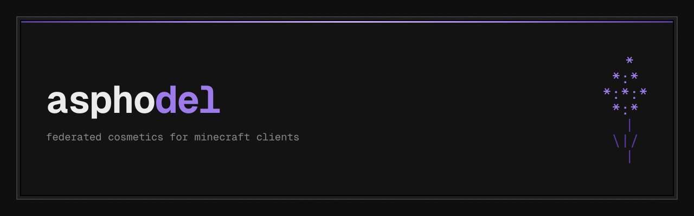

<p align="center"></p>

<p align="center"><b>One cosmetics catalog, shared by every Minecraft client on the network.</b></p>

Each client team runs its own Asphodel node. Nodes link up and sync a signed catalog of capes,
halos, wings, pets and emotes, plus equips and bans. A cosmetic one client publishes shows up for
the players of every other, and only the client that published it can change it.

| | |
| --- | --- |
| **Catalog** | [asphodel.wtf](https://asphodel.wtf): browse every public cosmetic |
| **API** | [asphodel.wtf/developers](https://asphodel.wtf/developers): read-only JSON, no key |
| **Terms / privacy** | [terms](https://asphodel.wtf/terms) · [privacy](https://asphodel.wtf/privacy) |

```
 *
*:*   asphodel
 |/
```
